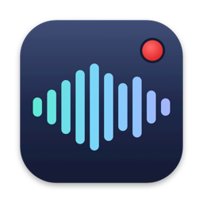
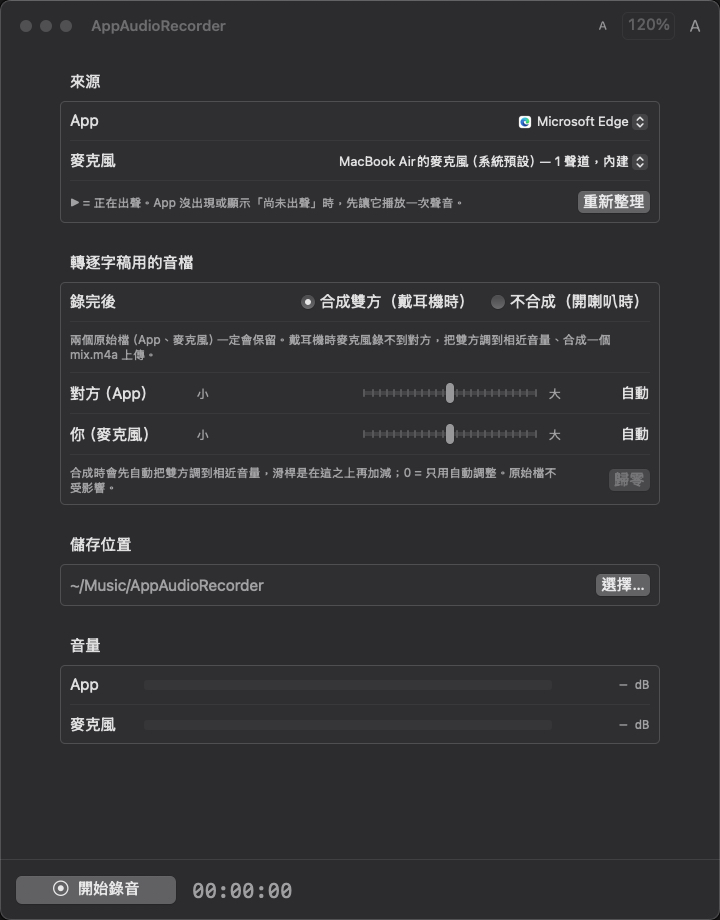
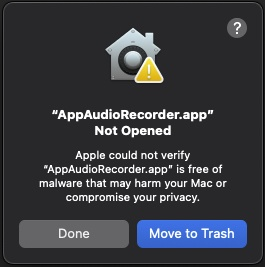
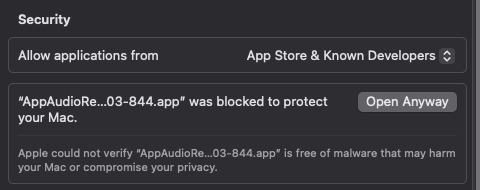
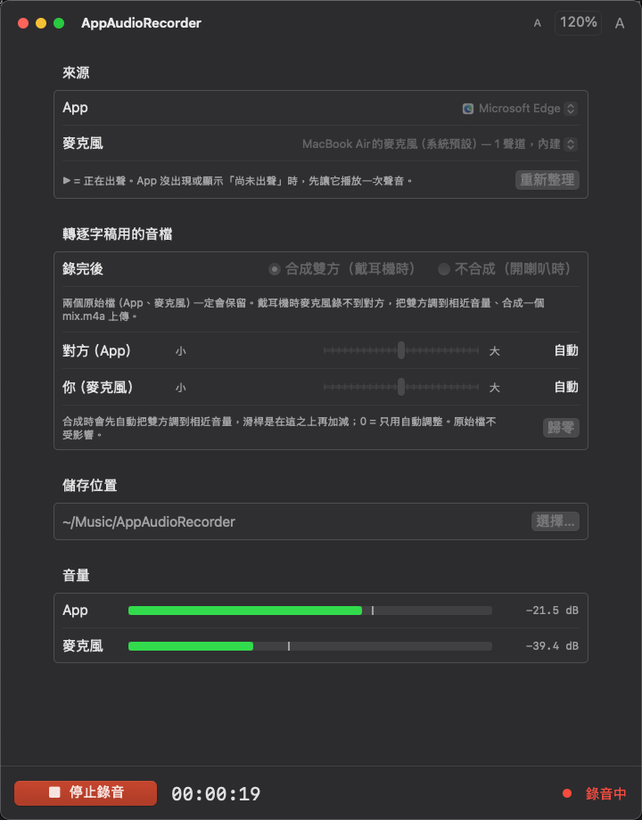
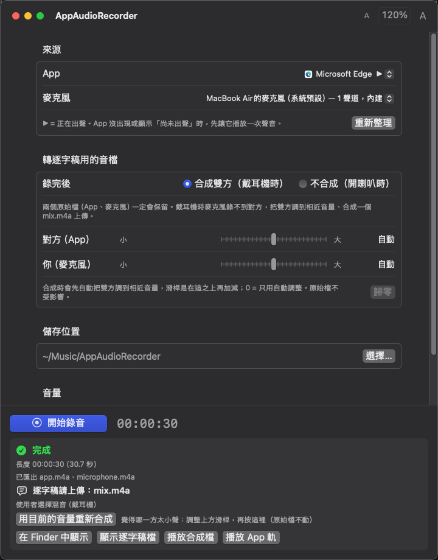

<p align="center">
  
</p>

<h1 align="center">AppAudioRecorder</h1>

<p align="center">
  <b>只錄你指定的 App，同時錄你的麥克風——戴著耳機也錄得到對方。</b><br>
  遠距訪談、線上會議、通話錄音，錄完直接得到一個可以拿去轉逐字稿的檔案。
</p>

<p align="center">
  
  
  
  
</p>

<p align="center">
  <a href="https://github.com/Dennishi0925/AppAudioRecorder/releases/latest"><b>⬇ 下載最新版本</b></a>
</p>

<p align="center">
  
</p>

---

## 它解決什麼問題

用電腦和別人通話或開會時，很多時候都必須戴耳機：

- 你在咖啡廳、圖書館或辦公室，不能把聲音放出來。
- 你在家裡，但不敢開太大聲，怕吵到室友或家人。
- 電腦喇叭已經開到最大，還是聽不清楚對方在說什麼。

但這時候想把對話錄下來，常見的做法都有問題：

- **戴耳機時，錄音程式錄不到對方**：對方的聲音只進了你的耳朵，麥克風收不到。
- **開喇叭錄，音質差又有回音**：還會錄到房間雜音。
- **系統錄音會錄到所有聲音**：通知聲、背景音樂全部混在一起。

AppAudioRecorder 直接從你指定的 App（例如 LINE、Zoom、瀏覽器）取得聲音，同時錄下你的麥克風。對方和你的聲音乾淨、分開保存，而且時間完全對齊。

## 主要功能

- **只錄指定的 App**：選 LINE，就只錄 LINE。其他 App 的聲音不會混進來。
- **也可以只錄其中一邊**：「麥克風」選「不錄麥克風」就只錄 App；「App」選「不錄 App」就只錄麥克風。
- **雙方分開保存**：對方的聲音、你的聲音各存一個檔，方便之後剪輯或整理。
- **一鍵產生轉逐字稿用的檔案**：錄完自動把雙方調到差不多大聲，合成一個檔，可以直接上傳到 Gemini 等轉文字工具。
- **音量可以微調**：覺得某一方太小聲，拉一下滑桿重新合成就好，不用重錄。
- **換耳機不會中斷**：錄音中拔掉或插上耳機，會自動接著錄，只有你按停止才結束。
- **錄完自動檢查**：如果錄音有異常（例如長度不對），結束時會直接提醒你。
- **完全離線**：不連網、不上傳，錄音只存在你自己的電腦裡。

---

## 安裝

### 系統需求

- macOS 14.4（Sonoma）或更新版本
- Apple Silicon 晶片的 Mac（M1、M2、M3、M4 系列）

### 步驟

1. 到 [Releases 頁面](https://github.com/Dennishi0925/AppAudioRecorder/releases/latest) 下載 `AppAudioRecorder-x.x.x.zip`。
2. 點兩下解壓縮，把 **AppAudioRecorder** 拖到「應用程式」資料夾。
3. 第一次打開時，macOS 會跳出警告，說無法確認這個 App 沒有惡意軟體（英文介面顯示：「Apple could not verify "AppAudioRecorder.app" is free of malware…」）。

   <p align="center">
     
   </p>

   **這是正常的，只需要處理一次。** 從網路下載、又沒有向 Apple 付費註冊並送審的 App，macOS 都會先擋下來；這不代表 App 有問題。這個專案的原始碼完全公開，你可以在這個頁面上查看。

   請照下面的步驟打開：

   1. 在警告視窗按 **「完成」**（Done）。**不要**按「丟到垃圾桶」（Move to Trash）。
   2. 打開 **「系統設定」**（System Settings），左邊選 **「隱私權與安全性」**（Privacy & Security）。
   3. 往下捲到 **「安全性」**（Security）區塊，會看到一行「已阻擋 "AppAudioRecorder.app" 以保護你的 Mac」（"AppAudioRecorder.app" was blocked to protect your Mac）。
   4. 按旁邊的 **「強制打開」**（Open Anyway）。

      

   5. 會再出現一次警告，這次有 **「強制打開」**（Open Anyway）按鈕，按下去，再輸入電腦的登入密碼。

   完成後就能正常使用，之後打開都不會再出現警告。

   > 找不到第 3 步那一行？先到「應用程式」資料夾點兩下 AppAudioRecorder，讓警告再出現一次，再馬上回到「隱私權與安全性」查看。那一行只會在被擋下後顯示大約一小時。

### 允許錄音權限

第一次按「開始錄音」時，macOS 會詢問兩項權限，請都按 **允許**：

| 權限 | 用途 |
|---|---|
| 錄製系統音訊 | 取得你指定的 App 的聲音（選了「不錄 App」時不會問） |
| 麥克風 | 錄下你的聲音（只有選了麥克風時才會問） |

不小心按了拒絕：到「系統設定 → 隱私權與安全性」，在「螢幕與系統錄音」和「麥克風」裡把 AppAudioRecorder 打開，然後重新開啟 App。

---

## 使用方式

### 錄音

1. **先讓要錄的 App 發出聲音**：例如先撥通 LINE 電話，或先播放影片。App 有聲音才會出現在清單裡，名稱旁的 ▶ 表示正在出聲。沒看到的話，按「重新整理」。
2. **選擇 App**：要錄哪個程式的聲音。只想錄自己的聲音，選最上面的 **「不錄 App（只錄麥克風）」**。
3. **選擇麥克風**：建議用 Mac 內建麥克風，或有線、USB 麥克風。
   > 💡 **只想錄 App 的聲音？** 打開「麥克風」選單，選最上面的 **「不錄麥克風（只錄 App）」**。適合錄線上課程、影片、直播這類不需要你出聲的內容。詳見下方[只錄其中一邊](#只錄其中一邊)。
4. **選擇錄完要不要合成**（只有錄麥克風時才會出現）：

   | 你的情況 | 請選 | 結果 |
   |---|---|---|
   | 戴耳機 | **合成雙方** | 產生 `mix.m4a`，裡面有雙方的聲音 |
   | 開喇叭 | **不合成** | 直接用 `microphone.m4a`，因為麥克風已經錄到雙方 |

5. 按 **開始錄音**。畫面上會顯示錄音時間，以及雙方的即時音量。

   <p align="center">
     
   </p>

6. 結束時按 **停止錄音**。程式會自動整理檔案，幾秒後顯示結果。

<p align="center">
  
</p>

### 只錄其中一邊

「App」和「麥克風」兩個選單的**第一個選項**都是「不錄」，平常不太會注意到，但很實用：

| 你想錄的 | 「App」選 | 「麥克風」選 | 會得到 |
|---|---|---|---|
| 訪談、通話（雙方都要） | 通話用的 App | 你的麥克風 | `app.m4a`、`microphone.m4a`，戴耳機時另有 `mix.m4a` |
| 線上課程、影片、直播（只要 App 的聲音） | 播放的 App | **不錄麥克風（只錄 App）** | 只有 `app.m4a` |
| 自己口述、練習簡報、錄現場（只要你的聲音） | **不錄 App（只錄麥克風）** | 你的麥克風 | 只有 `microphone.m4a` |

只錄一邊時：

- 「錄完要不要合成」的選項會自動隱藏，因為只有一軌，轉逐字稿直接用那一個 `.m4a`。
- 不錄麥克風：不會要求麥克風權限，也不會錄到你房間裡的聲音。
- 不錄 App：不會要求「錄製系統音訊」權限；錄音中換耳機、換喇叭也不會中斷。但如果**麥克風本身被拔掉**，因為沒有別的聲音可錄，會自動停止（已錄的部分會保留）。
- 錄音資料夾大約只佔一半空間。
- 兩邊不能都選「不錄」，這時「開始錄音」按鈕會變灰色。
- 選擇會被記住，下次打開還是一樣。**要錄訪談時，記得兩邊都切回來。**

### 錄完之後

結果畫面會告訴你：

- 錄了多久，過程中有沒有中斷。
- **要拿哪個檔去轉逐字稿**。
- 按「在 Finder 中顯示」可以直接打開錄音資料夾。

**覺得某一方太小聲？** 調整「對方」或「你」的滑桿，再按 **「用目前的音量重新合成」**，可以反覆調整到滿意為止。原始錄音不會被改動。

### 錄音檔存在哪裡

預設存在「音樂」資料夾裡的 `AppAudioRecorder`，每次錄音一個資料夾，以日期和時間命名，例如 `20261031-150140`。

| 檔案 | 內容 |
|---|---|
| `mix.m4a` | **雙方合成**，拿去轉逐字稿（選「合成雙方」時才有） |
| `app.m4a` | 對方的聲音 |
| `microphone.m4a` | 你的聲音 |
| `capture/` 資料夾 | 未壓縮的原始錄音（`app.caf`、`microphone.caf`），**檔案很大**，見下方說明 |
| `session.json` | 錄音紀錄（遇到問題回報時附上這個檔） |

儲存位置可以在畫面上按「選擇…」更改。

### 為什麼錄音資料夾這麼大？`capture/` 可以刪嗎？

你可能會發現 `capture/` 資料夾比 `.m4a` 大了十幾倍。這是正常的，因為它們是兩種不同的檔案：

| | `capture/` 裡的 `.caf` | `.m4a` |
|---|---|---|
| 是什麼 | 錄音當下的**原始資料**，完全沒壓縮 | 錄完後從 `.caf` **壓縮**出來的成品（AAC 格式） |
| 音質 | 原汁原味，一點都沒少 | 有損壓縮，但人耳幾乎聽不出差別，轉逐字稿完全夠用 |
| 大小（1 小時，參考值） | 對方一軌約 1.4 GB，你的麥克風一軌約 0.7 GB | 每個檔約 50–110 MB |
| 誰能打開 | QuickTime、Audacity 等專業軟體；很多網站、App 不接受 | 幾乎所有播放器、手機、Gemini 等轉文字工具都能用 |

**為什麼不直接錄成 m4a？** 錄音時一邊壓縮比較吃電腦資源，容易掉音；先存原始資料最穩，錄完再壓縮。萬一壓縮出問題，原始資料也還在，可以重新轉出。

**可以刪掉 `capture/` 嗎？** 一般使用的話，**有 m4a 就夠了，可以刪**。刪之前請確認：

1. 要用的 `.m4a`（`mix.m4a`、`app.m4a`、`microphone.m4a`）都打得開、聽起來正常。
2. 合成檔的音量已經調到滿意。**「用目前的音量重新合成」是從 `capture/` 的原始資料重做的，刪掉之後就不能再調整了。**
3. 你之後不需要做精細的後製剪輯（例如 Podcast 混音）；需要的話，保留 `.caf` 音質最好。

刪除方法：在錄音資料夾裡把 `capture` 資料夾丟到垃圾桶即可，其他檔案不受影響。

---

## 常見問題

<details>
<summary><b>清單裡找不到我要錄的 App</b></summary>

先讓那個 App 發出聲音（撥通電話、開始播放），再按「重新整理」。macOS 只會列出正在使用聲音的程式。
</details>

<details>
<summary><b>錄音資料夾好大，佔了好幾 GB</b></summary>

大的是 `capture/` 裡的未壓縮原始檔。確認 `.m4a` 都正常、音量也調好之後，可以把 `capture` 資料夾刪掉。詳見[為什麼錄音資料夾這麼大？](#為什麼錄音資料夾這麼大capture-可以刪嗎)
</details>

<details>
<summary><b>可以只錄 App，或只錄我自己的聲音嗎？</b></summary>

可以。只錄 App：「麥克風」選 **「不錄麥克風（只錄 App）」**。只錄自己：「App」選 **「不錄 App（只錄麥克風）」**。詳見[只錄其中一邊](#只錄其中一邊)。
</details>

<details>
<summary><b>錄完發現對方的聲音是空白的</b></summary>

- 確認已經允許「錄製系統音訊」權限（見上方「允許錄音權限」）。
- 確認選對了 App。例如用瀏覽器開會時，要選瀏覽器本身。
</details>

<details>
<summary><b>錄音中可以換耳機嗎？</b></summary>

可以，會自動接著錄。但切換的那一下（拔掉約 0.3 秒、插上約 1.5 秒）會變成無聲，這段時間對方說的話會漏掉。重要的訪談建議全程使用同一副耳機。
</details>

<details>
<summary><b>可以用藍牙耳機嗎？</b></summary>

可以用藍牙耳機**聽**。但如果同時用**藍牙耳機上的麥克風**，耳機會切換到通話模式，聲音品質會明顯變差。建議用藍牙耳機聽、用 Mac 內建麥克風錄。
</details>

<details>
<summary><b>結束時出現「檔案長度與實際時間不符」</b></summary>

代表錄音過程中可能出了問題，例如多了不該有的空白。請先重聽確認，也歡迎到 [Issues](https://github.com/Dennishi0925/AppAudioRecorder/issues) 回報，並附上那次錄音的 `session.json`。
</details>

<details>
<summary><b>錄別人的通話合法嗎？</b></summary>

各地法律不同。錄音前請先告知對方並取得同意，並遵守當地法規。
</details>

---

## 隱私

- 不連網、不上傳、不收集任何資料。
- 錄音只存在你選擇的資料夾，同一台電腦的其他使用者帳號無法讀取。
- 必須經過你在 macOS 上同意權限才能錄音，App 無法在你不知情時錄音。

## 目前的限制

- 只支援 Apple Silicon 的 Mac。
- 藍牙裝置、USB 麥克風、外接音效卡還沒有完整測試。
- 目前測試過最長約 30 分鐘的連續錄音。
- 麥克風如果在錄音中途斷線，之後就算重新接上，也不會再錄到你的聲音。

---

## 給開發者：從原始碼建置

不需要安裝 Xcode，只需要 Command Line Tools。

```bash
xcode-select --install          # 安裝 Command Line Tools（已安裝可跳過）
git clone https://github.com/Dennishi0925/AppAudioRecorder.git
cd AppAudioRecorder
bash scripts/build-app.sh       # 產生 build/AppAudioRecorder.app
open build/AppAudioRecorder.app
```

<details>
<summary><b>建立固定簽署憑證（避免每次重新建置都要重新允許權限）</b></summary>

1. 打開「鑰匙圈存取」，從選單選「鑰匙圈存取 → 憑證輔助程式 → 製作憑證…」。
2. 名稱填 **AppAudioRecorder Local**，身分類型選「自簽根憑證」，憑證類型選「程式碼簽署」。
3. 重新執行 `bash scripts/build-app.sh`。若 macOS 詢問是否允許使用鑰匙，選「永遠允許」。
4. 若仍提示找不到憑證：雙擊該憑證 →「信任」→「程式碼簽署」改為「永遠信任」。
</details>

<details>
<summary><b>命令列用法</b></summary>

```bash
.build/release/AppAudioRecorder list                                   # 列出正在出聲的程式
.build/release/AppAudioRecorder mics                                   # 列出麥克風
.build/release/AppAudioRecorder record edgemac -t 60 --mic default     # 錄 Edge + 麥克風 60 秒
.build/release/AppAudioRecorder transcript <錄音資料夾> mix --mic-db 3  # 重新合成，你的聲音大一點
.build/release/AppAudioRecorder export <錄音資料夾>                     # 重新轉出 m4a
```

不加參數執行可以看到完整說明。
</details>

---

## 版本紀錄

| 版本 | 新增／改進 |
|---|---|
| 0.9 | 可以只錄其中一邊：新增「不錄 App（只錄麥克風）」；README 說明錄音資料夾為什麼很大、`capture/` 何時可以刪 |
| 0.8 | 合成檔的音量滑桿，錄完可以調整後重新合成 |
| 0.7.5 | 錄完自動檢查長度；字體大小調整、視窗加大；選項簡化成「合成／不合成」；App 圖示 |
| 0.7 | 錄音中拔插耳機、換喇叭會自動接著錄 |
| 0.6 | 產生轉逐字稿用的合成檔，自動把雙方調到相近音量 |
| 0.5 | 圖形介面 |
| 0.4 | 錄完自動轉成 m4a |
| 0.3 | 雙方聲音時間完全對齊；不混入其他 App 的聲音 |
| 0.2 | 同時錄麥克風，雙方分開保存 |
| 0.1 | 錄下指定 App 的聲音 |

## 授權

[MIT License](LICENSE) © 2026 Dennishi0925
